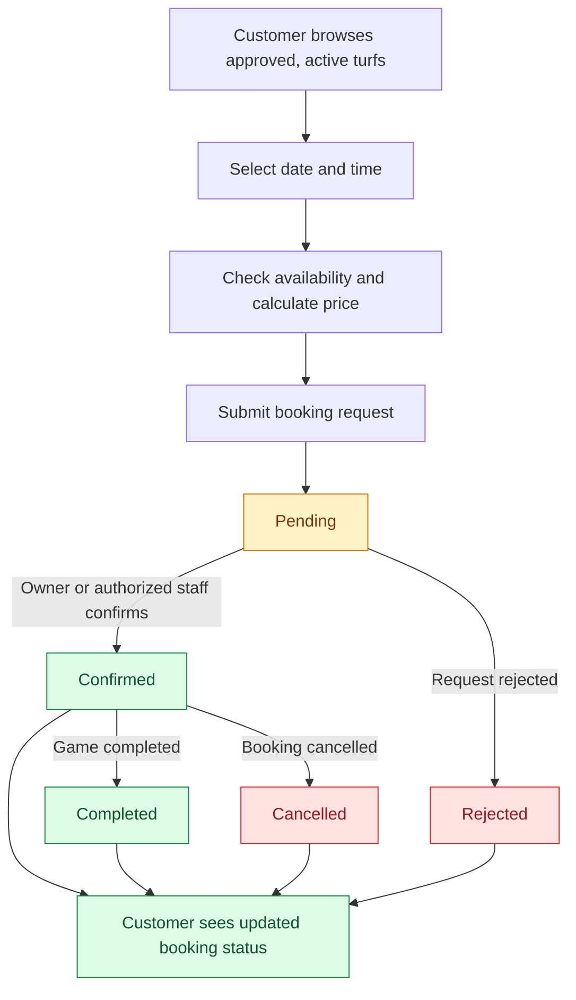
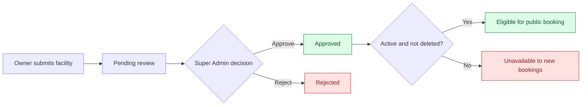
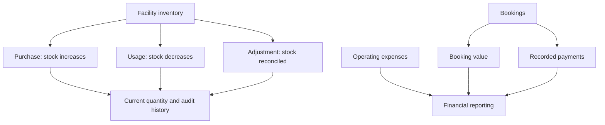
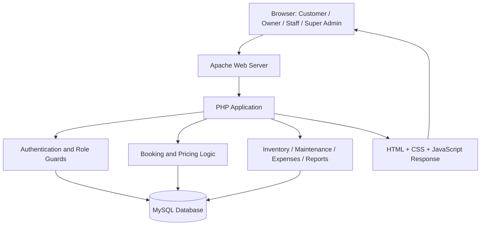
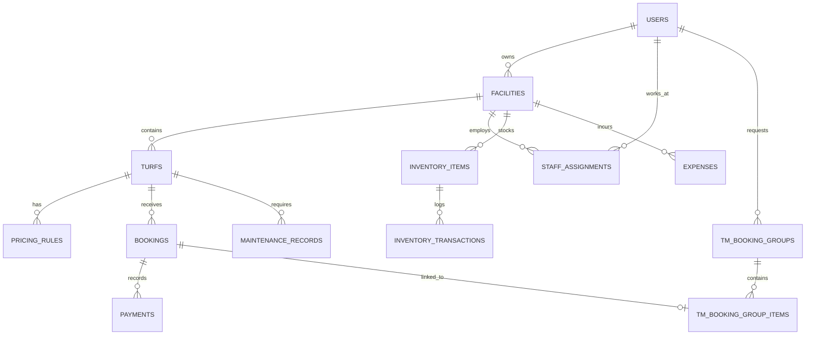

<div align="center">

<!-- Animated header images are rendered by third-party SVG services; the README still works if they are unavailable. -->


<a href="https://git.io/typing-svg"></a>

<p><strong>Your Game. Your Time. Your Turf.</strong></p>

<p>
  <a href="#-quick-start"></a>
  <a href="#-features-by-role"></a>
  <a href="#-how-turfmate-works"></a>
</p>


**A full-stack Web Technologies project** connecting turf discovery, reservations, facility operations, and platform administration in one LAMP-based application.

[Overview](#-overview) · [Features](#-features-by-role) · [Demo flow](#-end-to-end-demo-walkthrough) · [Database](#-database-design) · [Installation](#-quick-start) · [Security](#-security-and-data-privacy)

</div>

---

## 🌟 Overview

**TurfMate** is a role-based online turf booking and sports facility management system built with **PHP, MySQL, Apache, HTML, CSS, and JavaScript**. Instead of managing bookings through calls, scattered messages, or handwritten records, it brings customers and venue teams into one connected system.

- **Customers** discover venues, check availability, receive price quotations, reserve time slots, and track their bookings.
- **Owners** manage facilities, turfs, pricing, bookings, employees, inventory, maintenance, expenses, and business reports.
- **Staff** handle daily bookings and facility operations, limited to the venues assigned to them.
- **Super Admins** oversee users, owners, facility approvals, and platform-level reporting.

**Supported sports:** cricket, football, padel, and extensible sport categories.

> [!NOTE]
> TurfMate is currently designed for an **academic/local deployment**. Payment and financial modules record transactions and operating figures; they do **not** claim to process real payments through a live gateway.

### The problem we solve

| Without TurfMate | With TurfMate |
|:--|:--|
| Customers call or message venues to ask for availability | Customers browse turfs and inspect bookable time slots |
| Booking requests are scattered between phone and chat | Centralized booking records and status tracking |
| Double-bookings are difficult to prevent | Availability checks and conflict detection |
| Owners track costs, equipment, and payments separately | Inventory, expenses, maintenance, and reports in one panel |
| Staff may have unclear access to multiple venues | Facility-specific staff assignments and role permissions |
| New venues may be published without review | Super Admin facility approval workflow |

---

## 🧭 Explore the Project

<details open>
<summary><strong>📚 Jump to a section</strong></summary>

- [Features by role](#-features-by-role)
- [How TurfMate works](#-how-turfmate-works)
- [End-to-end demo walkthrough](#-end-to-end-demo-walkthrough)
- [Screenshots and video](#-screenshots-and-video)
- [Technology stack](#-technology-stack)
- [System architecture](#-system-architecture)
- [Project folder structure](#-project-folder-structure)
- [Database design](#-database-design)
- [Quick start](#-quick-start)
- [Security and data privacy](#-security-and-data-privacy)
- [Testing and verification](#-testing-and-verification)
- [Git collaboration](#-git-collaboration)
- [Roadmap](#-roadmap)

</details>

## ✨ Features by Role

<table>
<tr>
<td width="50%" valign="top">

### 👤 Customer Portal
**Discover • Reserve • Track**

- Customer registration, login, and profile
- Browse sports facilities and turfs
- Turf details, pricing, and availability
- Date/time selection and live quotation
- Multi-hour online bookings
- Overnight online reservations via booking groups
- Booking history and status tracking

**Booking states:** `pending` → `confirmed` → `completed`, with rejection/cancellation when applicable.

</td>
<td width="50%" valign="top">

### 🏟️ Owner Portal
**Manage • Analyze • Grow**

- Overview dashboard and booking metrics
- Facility and turf management
- Base prices and time-based pricing rules
- Booking review, confirmation, rejection, and completion
- Manual bookings for walk-in/phone/WhatsApp requests
- Staff accounts and facility assignments
- Inventory items, stock levels, and stock movements
- Maintenance scheduling and status tracking
- Expenses, payment records, and financial views
- Booking, inventory, and financial reports/exports

</td>
</tr>
<tr>
<td width="50%" valign="top">

### 👷 Staff Portal
**Operate • Assist • Update**

- Dashboard for assigned venues
- Booking lists and authorized status updates
- Walk-in/manual booking creation
- Facility information and pricing visibility
- Inventory operations within assigned facilities
- Maintenance operations for assigned turfs
- Access limited by **staff assignment** and venue status

**Important:** Staff do not receive owner-level financial reports or platform administration rights.

</td>
<td width="50%" valign="top">

### 🛡️ Super Admin Portal
**Review • Approve • Oversee**

- Platform-level dashboard
- Owner and user administration
- Review pending facility submissions
- Approve, reject, or suspend facilities
- Platform reporting and oversight
- Separate administrative permissions

**Important:** Super Admin registration is not a public sign-up option.

</td>
</tr>
</table>

### 🔐 Access and responsibility matrix

| Capability | Customer | Owner | Staff | Super Admin |
|---|:---:|:---:|:---:|:---:|
| Browse available turfs | ✅ | — | Assigned | Oversight |
| Create online reservations | ✅ | — | — | — |
| Manage booking requests | Own history | Own facilities | Assigned active facilities | — |
| Make manual bookings | — | ✅ | ✅ | — |
| Create/edit facilities and turfs | — | ✅ | Limited/read-only | Approval |
| Configure pricing | — | ✅ | Read-only | — |
| Manage staff assignments | — | ✅ | — | — |
| Inventory and maintenance | — | ✅ | Assigned facilities | — |
| Financial and operational reports | — | ✅ | — | Platform reports |
| Approve facilities / administer users | — | — | — | ✅ |

*Access is enforced server-side, not just by hiding navigation links.*

---

## 🔄 How TurfMate Works

### 1. The complete booking lifecycle



The booking engine validates the selected period, calculates pricing, and checks for overlapping reservations. Online reservations crossing midnight can use a logical booking group linked to multiple dated booking rows. **A group and its underlying bookings must maintain consistent statuses.**

### 2. Facility approval and visibility



Approval and operational status are separate checks. Owners may retain historical booking visibility when a venue is deactivated or soft-deleted; staff operational views exclude unavailable facilities.

### 3. Inventory and financial operations



**Booked revenue, collected payments, and operating expenses are distinct measurements.** Records are used to build reports, not to claim that money was transferred through an online payment provider.

---

## 🎬 End-to-End Demo Walkthrough

A suggested sequence for a university demonstration or narrated video:

| Scene | Role | What to demonstrate |
|:--:|:--|:--|
| 01 | **Super Admin** | Review and approve a facility submitted by an Owner |
| 02 | **Owner** | Configure a turf, hourly price, and peak-time pricing rule |
| 03 | **Customer** | Browse approved turfs, inspect slots, and book a cricket turf |
| 04 | **Customer** | See the new reservation marked **Pending** |
| 05 | **Owner** | Open the booking and **Confirm** it |
| 06 | **Customer** | Refresh booking history and see **Confirmed** |
| 07 | **Staff** | Open the booking in an assigned facility and mark it **Completed** |
| 08 | **Owner** | Review updated booking statistics, inventory, expenses, and reports |

> [!TIP]
> For the clearest demo, use separate demo accounts for each role, perform a **fresh booking**, and show its status moving between the different portals. Avoid showing passwords, personal phone numbers, or database credentials in recordings.

## 📸 Screenshots and Video

Screenshots and a demonstration video can be added without changing application code.

<!-- Add actual files before uncommenting these lines:


[â–¶ Watch the TurfMate walkthrough](https://YOUR_DEMO_VIDEO_URL)
-->

| Showcase | What to capture |
|---|---|
| 🏠 Home | Landing page and sports discovery |
| 🏏 Customer | Turf availability, quotation, and booking history |
| 📊 Owner | Dashboard, staff management, inventory, finance, and reports |
| 🛠️ Staff | Assigned-facility bookings and daily operations |
| 🛡️ Super Admin | Facility approval and platform overview |

**Suggested location for image files:** `docs/screenshots/`. Once added, uncomment the Markdown images above and replace the demo-video placeholder with your actual link. No screenshots or video links have been invented here.

---

## 🧰 Technology Stack

<div align="center">

| Layer | Technology | Purpose |
|---|---|---|
| Client | **HTML5, CSS3, JavaScript** | UI, forms, responsive pages |
| Server-side | **PHP** | Business logic, authentication, bookings, reports |
| Web server | **Apache HTTP Server** | Local web hosting and PHP execution |
| Data | **MySQL** | Relational data, constraints, transactions |
| Database access | **PDO** | Parameterized SQL operations |
| Development | **Ubuntu / LAMP** | Linux-based development environment |
| Collaboration | **Git + GitHub** | Version history and teamwork |
| Local VM (optional) | **VirtualBox** | Running Ubuntu on a host computer |

</div>

## 🏗️ System Architecture



**Architecture:** A traditional server-rendered PHP application using shared database access, role-specific modules, and session-based authorization. It does not require a separate frontend framework or microservice stack.

---

## 🗂️ Project Folder Structure

<details open>
<summary><strong>📁 Expand the main source tree</strong></summary>

```text
TurfMate/
├── index.php                   # Public entry / homepage
├── auth/                       # Login, registration, logout
│   ├── login.php
│   ├── register.php
│   └── logout.php
├── customer/                   # Customer browsing and booking
│   ├── dashboard.php
│   ├── turfs.php
│   ├── turf-details.php
│   ├── turf-availability.php
│   ├── booking_engine.php
│   ├── booking-quote.php
│   ├── my-bookings.php
│   └── profile.php
├── owner/                      # Venue/business administration
│   ├── dashboard.php
│   ├── facilities.php
│   ├── turfs.php
│   ├── pricing_rules.php
│   ├── bookings.php
│   ├── booking-actions.php
│   ├── manual-booking.php
│   ├── staff.php
│   ├── inventory.php
│   ├── inventory-transactions.php
│   ├── maintenance.php
│   ├── expenses.php
│   ├── reports.php
│   ├── reports-bookings.php
│   ├── reports-inventory.php
│   ├── reports-financial.php
│   └── reports-export.php
├── staff/                      # Assigned facility operations
│   ├── dashboard.php
│   ├── bookings.php
│   ├── manual-booking.php
│   ├── facilities.php
│   ├── inventory.php
│   └── maintenance.php
├── super-admin/                # Platform-level administration
│   ├── dashboard.php
│   ├── facilities.php
│   ├── owners.php
│   ├── users.php
│   └── reports.php
├── includes/                   # Auth and shared functions
│   ├── auth.php
│   ├── db.php
│   └── functions.php
├── config/
│   └── database.php            # Loads local .env and creates PDO
├── database/
│   ├── schema.sql              # Database schema source
│   └── migrations/             # Incremental SQL migrations
├── assets/
│   ├── css/                    # Page / module styling
│   ├── images/                 # Sports and site imagery
│   └── js/                     # Front-end scripts
├── README.md
└── .gitignore
```

</details>

<details>
<summary><strong>🧩 What the most important files do</strong></summary>

| File | Responsibility |
|---|---|
| `config/database.php` | Reads local database settings and returns a PDO connection |
| `includes/auth.php` | Session handling and role access checks |
| `customer/booking_engine.php` | Validates bookings, quotes prices, and checks availability |
| `customer/my-bookings.php` | Displays customer booking history and status |
| `owner/booking-actions.php` | Handles allowed owner-side status transitions |
| `owner/_booking_helpers.php` | Shared owner booking lookups and locking helpers |
| `staff/_init.php` | Staff session and facility assignment checks |
| `super-admin/facilities.php` | Facility approval oversight |
| `database/schema.sql` | Schema definition used by the project |

</details>

---

## 🗄️ Database Design

TurfMate uses a relational schema that connects users, venues, reservations, payment records, operations, and reporting.

| Table | Purpose |
|---|---|
| `users` | Customer, Owner, Staff, and Super Admin accounts |
| `facilities` | Venue ownership, contact information, operational and approval status |
| `turfs` | Sports grounds, facilities, capacity, and base prices |
| `pricing_rules` | Day/time-based turf pricing |
| `bookings` | Individual reservation records and their status |
| `tm_booking_groups` | Logical online reservations, including multi-segment bookings |
| `tm_booking_group_items` | Links a booking group to underlying booking rows |
| `customer_booking_requests` | Legacy/additional customer request records |
| `payments` | Recorded booking payments and refunds |
| `staff_assignments` | Facility-specific staff access |
| `inventory_items` | Stock items and low-stock thresholds |
| `inventory_transactions` | Purchases, usage, and adjustments |
| `maintenance_records` | Turf repair and maintenance schedules |
| `expenses` | Facility operating costs |

### Entity relationships at a glance



> [!IMPORTANT]
> The ERD is **conceptual**, not a complete column-by-column schema. The authoritative table and foreign-key definitions are in the SQL schema and migrations. The unused `operating_hours` table is intended to be removed; verify that your actual database and `database/schema.sql` are consistent before considering cleanup finished.

---

## 🚀 Quick Start

### Prerequisites

- Ubuntu (or another Apache + PHP + MySQL environment)
- Apache, PHP, MySQL and PHP's `pdo_mysql` extension
- Git
- A **private**, team-approved database schema or SQL dump

### 1. Install the LAMP dependencies (Ubuntu)

```bash
sudo apt update
sudo apt install apache2 mysql-server php libapache2-mod-php php-mysql php-mbstring git
sudo systemctl start apache2
sudo systemctl start mysql
```

### 2. Clone TurfMate

```bash
cd /var/www/html
git clone https://github.com/daw159/TurfMate-.git turfmate
cd turfmate
```

If you already have the repository, update it with `git pull --ff-only origin main` after checking `git status`.

### 3. Create and populate your local database

```bash
sudo mysql -e "CREATE DATABASE IF NOT EXISTS turfmate CHARACTER SET utf8mb4 COLLATE utf8mb4_unicode_ci;"
```

Import a SQL dump received **privately** from the team (example filename only):

```bash
sudo mysql turfmate < ~/Downloads/turfmate_final_database.sql
```

**Caution:** An imported dump may contain statements that overwrite existing tables. Back up any existing `turfmate` database before importing, and do not publish team dumps to GitHub.

If starting from `database/schema.sql` instead, check whether additional migrations and seed data are required. A schema-only setup may not provide the Super Admin account or sample records.

### 4. Configure local database credentials

Create a `.env` file in the project root:

```dotenv
DB_HOST=localhost
DB_NAME=turfmate
DB_USER=your_local_mysql_user
DB_PASS=your_local_mysql_password
```

Create/grant a local MySQL user with appropriate privileges for the application. The example credentials above are **placeholders**. `.env` must remain private and out of Git.

### 5. Launch the website

Open the application at:

**`http://localhost/turfmate/`**

Direct login URL: **`http://localhost/turfmate/auth/login.php`**

Public registration supports Customer and Owner accounts. Staff access is provisioned by an Owner; Super Admin access should be provisioned privately.

<details>
<summary><strong>🛠️ Troubleshooting installation</strong></summary>

```bash
# Verify services
sudo systemctl status apache2
sudo systemctl status mysql

# Check PHP extensions
php -m | grep -Ei 'PDO|pdo_mysql|mbstring'

# Check syntax across application modules
find auth customer owner staff super-admin -name '*.php' -print0 | xargs -0 -n1 php -l

# Inspect server errors
sudo tail -n 50 /var/log/apache2/error.log
```

If login redirects fail, verify the app directory is `/turfmate`, database connection settings are correct, and Apache is serving the expected checkout.

</details>

---

## 🔒 Security and Data Privacy

**Existing design foundations:**

- Session-based authentication and role checks
- Password hashing and verification
- Server-side checks for Owner ownership and Staff assignments
- PDO prepared queries for database operations
- CSRF protection for relevant state-changing requests
- Facility approval and operational-status restrictions
- Transactions/locking in booking workflows to reduce conflicts

**Before a public deployment**, independently review CSRF/authorization on every action, HTTPS and cookie settings, error handling, upload security, database grants, and backup procedures. A local academic demo should not be interpreted as a security audit.

> [!CAUTION]
> Never commit `.env`, `.env.test`, real database exports, account credentials, customer contact data, or private recordings. If sharing demo data, anonymize personal information and share through an appropriate private channel.

### Booking and facility rules worth preserving

1. New bookings should target **approved, active, non-deleted** facilities and eligible turfs.
2. Staff access must be checked against **active assignments**, not merely staff role.
3. Owners should retain historical records for deactivated/soft-deleted facilities.
4. Booking status updates should keep `bookings` and associated `tm_booking_groups` consistent.
5. Multi-segment groups require explicit group-level status handling; copying one segment's status to the entire group may be incorrect.

---

## 🧪 Testing and Verification

Testing should cover both page access **and** the data changing correctly across roles.

| Area | Example verification |
|---|---|
| Authentication | Correct logins; incorrect passwords and cross-role access rejected |
| Facility approval | Unapproved venues excluded from customer discovery |
| Staff isolation | Employee only accesses assigned eligible facilities |
| Booking conflicts | Overlapping confirmed slots cannot be booked |
| Booking lifecycle | Pending → Confirmed → Completed correctly reflected across portals |
| Cancellation/rejection | Correct allowed transitions and status visibility |
| Overnight bookings | Multi-day booking segments remain consistent |
| Inventory | Purchases, usage, adjustments and stock validation |
| Financial records | Payments and expenses correctly represented in reports |
| Historical data | Owner retains past bookings for inactive facilities |

**Previously observed local test run:** 114 checks passed, with **2 automated HTTP failures** for Owner reporting endpoints. Those report pages were also checked manually and opened, but manual success does not prove the automated failures were fixed. Subsequent changes to booking actions should be revalidated independently. Do not present this historical result as a fully passing final test suite.

If you retain the local automated test tools, their usage may be documented in `README-TESTING.txt`. Test scripts and `.env.test` may be excluded from the public repository; they are not needed to run the normal website.

---

## 🤝 Git Collaboration

This is a shared source-code repository. **Git synchronizes files, not MySQL records.** Each teammate keeps their own database configuration and must import/apply database changes separately.

```bash
# Inspect local changes
git status

# Pull teammates' work when safe
git pull --ff-only origin main

# Commit a specific documentation update
git add README.md
git commit -m "docs: redesign TurfMate README"

# Share changes
git push origin main
```

- Do not commit local database dumps or credentials.
- Add schema changes as SQL migrations and communicate their application order.
- Avoid force-pushing shared `main`.
- Use Git history to review contributions, not as a sole measure of teamwork.

**Repository:** [github.com/daw159/TurfMate-](https://github.com/daw159/TurfMate-)

---

## 🛣️ Roadmap

Potential future enhancements (**not claimed as implemented**):

- [ ] Email/WhatsApp booking notifications and reminders
- [ ] Online payment gateway integration
- [ ] Stronger automated end-to-end checks and CI
- [ ] Audit logging for booking, inventory, and financial actions
- [ ] Better analytics and configurable reporting
- [ ] Production deployment, HTTPS, monitoring and scheduled backups
- [ ] Additional accessibility and mobile UX improvements

## 🎓 Academic Project

| | |
|---|---|
| **Project** | TurfMate — Online Turf Booking & Sports Facility Management System |
| **Course context** | Web Technologies |
| **Approach** | LAMP stack, role-based access, relational database |
| **Development environment** | Ubuntu Linux (including VirtualBox-based local development) |
| **Source code** | [TurfMate on GitHub](https://github.com/daw159/TurfMate-) |
| **License** | Not specified; do not assume an open-source license without a `LICENSE` file |

---

<div align="center">

### 🏏 TurfMate

**Less paperwork. Smarter bookings. Better turf management.**


</div>
