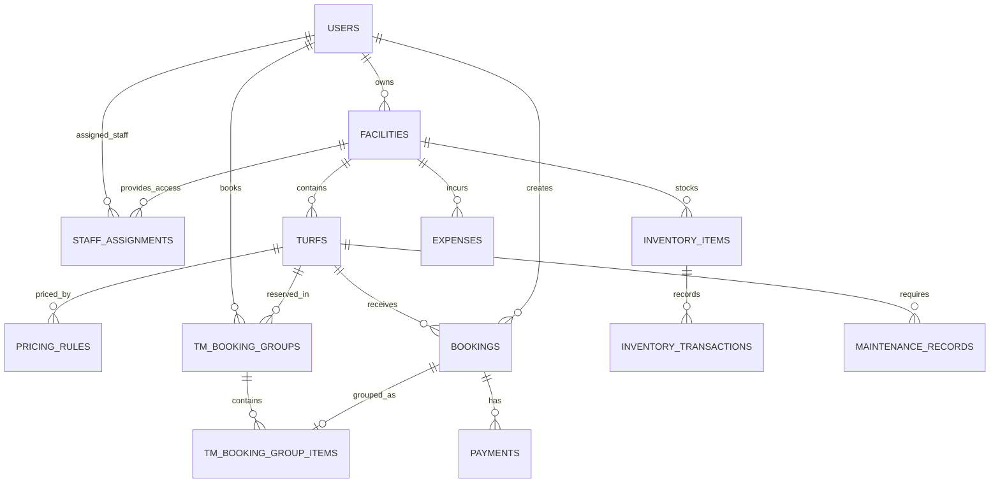

# TurfMate

**Online Turf Booking & Sports Facility Management System**  
*A multi-role web application for customers, facility owners, staff, and platform administrators.*


## Contents

1. [Overview](#overview)
2. [Problem and solution](#problem-and-solution)
3. [Users and permissions](#users-and-permissions)
4. [Features by module](#features-by-module)
5. [Application workflows](#application-workflows)
6. [Technology stack](#technology-stack)
7. [Project structure](#project-structure)
8. [Database design](#database-design)
9. [Local installation](#local-installation)
10. [Configuration and security](#configuration-and-security)
11. [Testing guide](#testing-guide)
12. [Collaboration and Git workflow](#collaboration-and-git-workflow)
13. [Known limitations and future improvements](#known-limitations-and-future-improvements)
14. [Project documentation and ownership](#project-documentation-and-ownership)

---

## Overview

**TurfMate** combines online sports-ground discovery and bookings with day-to-day facility administration. Customers can explore sports turfs, view prices, request/book time slots, and track their bookings. Facility owners manage venues, turf information, prices, staff, bookings, equipment, expenses, maintenance, and operational/financial reports. Assigned staff help run bookings and facility operations. A Super Admin supervises platform users, owners, and facility approval.

Sports supported in the database include **cricket, football, padel, and other**. Pricing, capacity, availability, and facility status are associated with individual turfs.

**Scope:** Educational/local LAMP-stack web application. Financial features record booking charges, payments and expenses; they are not a payment-gateway or formal accounting integration.

## Problem and solution

### Problems addressed

- Customers otherwise have to contact venues individually to ask about available slots and prices.
- Owners may maintain disconnected records for bookings, payments, equipment, expenses and repairs.
- Manual coordination can lead to overlapping bookings, inconsistent pricing and incomplete stock history.
- Multi-facility businesses need to limit what employees can access.
- A platform hosting different owners needs an approval process for new facilities.

### TurfMate's approach

A shared MySQL database connects customers, facilities, turfs, booking records, pricing rules, payments, inventory, maintenance and staff assignments. Role-specific PHP interfaces present only the relevant operations, and server-side checks enforce access rules.

## Users and permissions

| Area | Customer | Owner | Assigned staff | Super Admin |
|---|---|---|---|---|
| Browse approved, active turfs | Yes | — | Read-only (assigned) | Oversight |
| Make online booking | Yes | — | — | — |
| View own bookings | Yes | — | — | — |
| Manage venue / turf details | — | Own venues | Read-only | Approval / oversight |
| Configure turf pricing | — | Own turfs | Read-only | — |
| Review / update bookings | Own bookings (limited) | Own venues | Assigned venues | — |
| Create manual booking | — | Own venues | Assigned venues | — |
| Create and assign staff | — | Own team | — | — |
| Inventory and stock transactions | — | Own venues | Assigned venues | — |
| Maintenance records | — | Own venues | Assigned venues (operational management) | — |
| Expenses, finance and owner reports | — | Own venues | Not available | Platform reporting only |
| Approve / reject / suspend facilities | — | — | — | Yes |
| Manage platform users and owners | — | — | — | Yes |

**Important permission rules**

- A public visitor can register as a **Customer** or **Owner**. **Staff** accounts are managed privately by owners; Super Admin accounts are not available through public registration.
- New facilities require **Super Admin approval** before they can be publicly bookable.
- Staff access is granted through `staff_assignments` and is limited to approved, active facilities to which the employee is assigned. Disabled staff accounts and inactive assignments must not retain access.
- Staff maintenance management is operational; **maintenance costs and financial reporting remain Owner-only**.
- Owner data is scoped to the facilities that owner controls. An authenticated role does not imply permission to access every facility.

> UI hiding alone is not authorization. Every page and POST action should verify the logged-in user's role and the relevant facility ownership/assignment on the server.

## Features by module

### Customer portal (`customer/`)

- Dashboard and turf browsing/discovery.
- Turf information including sport, venue, base/rule-based prices and booking options.
- Booking quotation and time-slot selection, with protection against conflicting bookings.
- Support for online bookings that can cross midnight through linked booking groups and date-specific segments.
- Booking history/status and customer profile.

### Owner portal (`owner/`)

- **Dashboard:** summary of facility activity and key operational metrics.
- **Facilities:** register and maintain venues; monitor platform approval status.
- **Turfs:** create and edit sports grounds, base prices, capacities and statuses.
- **Pricing rules:** configure differentiated charges by day, time window and optional validity period.
- **Bookings:** view/review bookings, confirm/reject pending requests, complete/cancel confirmed bookings, and inspect details.
- **Manual booking:** register walk-in, phone or WhatsApp bookings and record an optional advance.
- **Staff management:** create staff accounts, assign/reassign approved facilities, disable access and remove team assignments.
- **Inventory:** create and maintain items, available quantities and low-stock thresholds.
- **Stock transactions:** log purchases, consumption/usage and quantity adjustments.
- **Maintenance:** track repair/maintenance tasks on turfs, schedules, status and owner-side costs.
- **Expenses:** record operating expenditures by facility, category and date.
- **Reports:** operational booking reports and financial views of booking revenue, collected payments and expenses.

### Staff portal (`staff/`)

- Operational dashboard for assigned facilities.
- Booking lists, status transitions and manual bookings.
- Read-only facility/turf/pricing information.
- Inventory item and transaction management within permitted facilities.
- Maintenance record creation, editing and status management for assigned facilities; **no financial-cost access**.
- No Owner/Super Admin account management, venue approval or financial-report permissions.

### Super Admin portal (`super-admin/`)

- Platform dashboard and administrative navigation.
- Review and approve, reject or suspend submitted facilities.
- Owner and user management.
- Platform-level reports and oversight.

## Application workflows

### 1. Owner onboarding and facility approval

```text
Visitor registers as Owner
          |
          v
Owner logs in -> creates facility -> approval_status = pending
          |
          v
Super Admin reviews facility
          |
      +---+--------------------+
      |                        |
   Approved             Rejected / Suspended
      |                        |
      v                        v
Available for eligible    Not publicly bookable
customer bookings
```

Approval is a separate concept from the facility's `active`/`inactive` operational state; a facility must satisfy both applicable conditions.

### 2. Customer online booking

```text
Customer logs in
   -> browses approved + active facilities/turfs
   -> selects date, start and end times
   -> receives quoted price (base price + applicable pricing rules)
   -> submits booking
   -> owner/staff reviews pending booking
   -> confirmed or rejected
   -> completed or cancelled (when applicable)
```

**Typical status transitions:**

```text
pending -> confirmed -> completed
   |           |
   v           v
rejected    cancelled
```

Online overnight reservations may be represented by one logical record in `tm_booking_groups` linked to one or more dated rows in `bookings` using `tm_booking_group_items`. Group and segment statuses should stay synchronized.

### 3. Manual booking and payments

```text
Owner / assigned staff selects a turf
   -> enters customer/contact and a same-day slot
   -> validates price, permission and overlap
   -> saves booking
   -> optionally logs advance payment
   -> owner financial reports reflect the records
```

The inspected Owner manual-booking implementation rejects overnight manual reservations; online booking handles crossing midnight separately. The database stores payment **records** (`payments`); it does not imply integration with JazzCash/EasyPaisa APIs or real-money transfer automation.

### 4. Stock management

```text
Inventory item (quantity, unit, reorder_level)
          |
          +-> purchase   (+ stock)
          +-> usage      (- stock)
          +-> adjustment (+/- stock)
          |
          v
Current quantity and transaction history
```

For example, 20 cricket balls + 10 purchased − 4 used = **26 available**. Quantity should never become negative, and every recorded movement should have an accountable user.

### 5. Maintenance, expenses and reports

- Maintenance records reference a specific turf, with `planned`, `in_progress` or `completed` status.
- Expenses reference a facility, amount, category and expense date.
- Payments reference an existing booking and can be `received` or `refunded`.
- Owner reports aggregate data already present in bookings, payments, expenses and related tables. **Booked revenue**, **money collected** and **expenses** are different measures and should not be conflated.

## Technology stack

| Layer | Technology | Purpose |
|---|---|---|
| Frontend | HTML, CSS, JavaScript | Role-specific screens, forms and responsive layouts |
| Backend | PHP | Routing through PHP pages, validation, business logic, session handling |
| Database | MySQL 8.x | Relational records, foreign keys, transactions and reports |
| Web server | Apache | Local HTTP server |
| Development environment | Ubuntu / LAMP | Development and local demonstration |
| Version control | Git / GitHub | Commits, collaboration and migrations |
| Database access | PHP PDO | Prepared queries and database connections |

The shared database dump was generated with MySQL **8.4.x**. Other versions may work but should be tested for SQL compatibility.

## Project structure

The structure below combines inspected source folders with subsequent modules implemented during the project. Specific filenames can vary with the latest Git commit.

```text
TurfMate/
├── index.php                   # Public landing/entry page (where present)
├── .env                        # Local DB credentials: never commit
├── .gitignore
├── README.md
│
├── auth/
│   ├── login.php
│   ├── register.php
│   └── logout.php
│
├── customer/
│   ├── dashboard.php
│   ├── turfs.php
│   ├── turf-details.php
│   ├── booking-quote.php
│   ├── booking_engine.php
│   ├── _booking_common.php
│   ├── my-bookings.php
│   └── profile.php
│
├── owner/
│   ├── _init.php              # Owner role, PDO and shared helpers
│   ├── _layout.php            # Owner navigation/layout
│   ├── dashboard.php
│   ├── facilities.php
│   ├── turfs.php
│   ├── pricing_rules.php
│   ├── bookings.php
│   ├── booking-actions.php
│   ├── booking-details.php
│   ├── customer-bookings.php
│   ├── manual-booking.php
│   ├── staff.php              # Owner-managed staff accounts/assignments
│   ├── inventory.php
│   ├── inventory-transactions.php
│   ├── maintenance.php
│   ├── expenses.php
│   ├── expenses-inventory.php
│   ├── reports.php
│   ├── reports-bookings.php   # If present in current checkout
│   └── reports-financial.php
│
├── staff/
│   ├── _init.php              # Staff authentication and permissions
│   ├── dashboard.php
│   ├── bookings.php
│   ├── manual-booking.php
│   ├── facilities.php
│   ├── inventory.php
│   └── maintenance.php
│
├── super-admin/
│   ├── dashboard.php
│   ├── facilities.php         # Facility approval workflow
│   ├── owners.php
│   ├── users.php
│   ├── reports.php
│   └── _management.php        # Shared admin helpers/layout
│
├── includes/
│   ├── auth.php               # Session and role checks
│   ├── db.php
│   └── functions.php
│
├── config/
│   └── database.php           # Reads .env; returns a PDO connection
│
├── database/
│   └── migrations/
│       └── 20261108_remove_operating_hours.sql
│
└── assets/
    ├── css/                   # Per-module and shared stylesheets
    ├── js/                    # Where present
    └── images/                # Where present
```

The path is commonly `/var/www/html/turfmate` on the project's Ubuntu Apache environment. **Use `git ls-files` to check the exact current repository tree.**

## Database design

### Core tables (final shared database)

| Table | Responsibility | Key relationships |
|---|---|---|
| `users` | Customer, owner, staff and Super Admin accounts | Referenced by ownership, creation and assignment records |
| `facilities` | Venues, owner, status and platform approval | `owner_id -> users.id` |
| `turfs` | Sports grounds, base price, capacity and status | `facility_id -> facilities.id` |
| `pricing_rules` | Time/day-specific pricing | `turf_id -> turfs.id` |
| `bookings` | Individual reservation records | `turf_id -> turfs.id`; customer and creator -> `users` |
| `tm_booking_groups` | Logical online booking covering one or more date segments | Customer -> `users`; turf -> `turfs` |
| `tm_booking_group_items` | Joins a booking group to underlying bookings | `group_id -> tm_booking_groups`; `booking_id -> bookings` |
| `customer_booking_requests` | Customer-submitted request records | Stores customer/turf references in its columns |
| `payments` | Booking payment entries | `booking_id -> bookings.id` |
| `staff_assignments` | Facility-level staff access | `staff_id -> users.id`; `facility_id -> facilities.id` |
| `inventory_items` | Items, counts and reorder thresholds | `facility_id -> facilities.id` |
| `inventory_transactions` | Purchases, usage and adjustments | `item_id -> inventory_items.id`; `created_by -> users.id` |
| `maintenance_records` | Turf repair/maintenance records | `turf_id -> turfs.id`; `created_by -> users.id` |
| `expenses` | Owner-recorded operating expenditure | `facility_id -> facilities.id`; `created_by -> users.id` |

**Schema update:** `operating_hours` was removed as an unused table. The Git-tracked migration is `database/migrations/20261108_remove_operating_hours.sql`. This does **not** remove `pricing_rules`: they are different concepts. The current booking model relies on turf status, date/time and pricing-rule logic rather than a separate operating-hours table.

**ERD overview** (Mermaid-supported GitHub rendering):



This is a conceptual ERD of major associations, not a full column-by-column physical model. Some user references are optional or represented by additional keys.

## Local installation

### Prerequisites

- Ubuntu (or another environment running Apache, PHP and MySQL).
- PHP with `pdo_mysql` and common application extensions such as `mbstring`.
- MySQL server with an application database/user.
- Git (and optionally GitHub CLI).
- Repository access, plus a **private** database dump supplied by the team or a separately maintained schema/setup process.

### 1. Get the project

For an existing checkout:

```bash
cd /var/www/html/turfmate
git status
git pull --ff-only origin main
```

For a new checkout (use the team's repository URL):

```bash
cd /var/www/html
git clone https://github.com/daw159/TurfMate-.git turfmate
cd turfmate
```

### 2. Prepare the database

Create a **backup** before replacing an existing database:

```bash
sudo mysqldump --single-transaction turfmate > ~/turfmate_backup.sql
```

For a fresh local installation, create the database:

```bash
sudo mysql -e "CREATE DATABASE IF NOT EXISTS turfmate CHARACTER SET utf8mb4 COLLATE utf8mb4_unicode_ci;"
```

Import the **team-approved SQL dump** from a private path. Example:

```bash
sudo mysql turfmate < ~/Downloads/turfmate_before_cleanup.sql
```

> **Destructive operation:** A full dump containing `DROP TABLE IF EXISTS` can replace existing records. Use a testing database and a backup. Do not publish SQL dumps containing users, passwords/hashes, phone numbers or personal information.

Apply schema migrations **only if needed**. For example, if the imported dump still contains the old table:

```bash
sudo mysql turfmate < database/migrations/20261108_remove_operating_hours.sql
```

Verify the expected tables:

```bash
sudo mysql turfmate -e "SHOW TABLES; SHOW TABLES LIKE 'operating_hours';"
```

The second query should have no matching table after cleanup.

### 3. Configure `.env`

`config/database.php` reads a root-level `.env` file with the following keys:

```dotenv
DB_HOST=localhost
DB_NAME=turfmate
DB_USER=turfmate_user
DB_PASS=your_local_database_password
```

Create a local database user and grant only the permissions needed by the app. **Never commit a real `.env` file.** The values above are placeholders, not valid credentials.

### 4. Start services and confirm PHP access

```bash
sudo systemctl start apache2
sudo systemctl start mysql
php -m | grep -Ei 'PDO|pdo_mysql|mbstring'
```

Open the site at:

`http://localhost/turfmate/`

Typical role login entry point: `http://localhost/turfmate/auth/login.php`.

### 5. Check access for each role

- Register a Customer or Owner through public registration.
- Use a **team-provisioned** Super Admin account for approvals; do not make Super Admin publicly registrable.
- Use an Owner account to create/assign Staff accounts.
- If a restored dump contains seeded accounts, obtain credentials privately from their owner. **Do not put credentials in README or Git.**

## Configuration and security

### Implemented foundations visible in the project

- Role-based access checks via `includes/auth.php` and area-specific initialization.
- Session authentication, current database account/role checks and a session inactivity timeout.
- Password hashing for stored user passwords.
- PDO with prepared statements and `utf8mb4` connection charset.
- CSRF tokens on many state-changing forms.
- Scoped queries for owner-managed and staff-assigned facilities.
- Foreign keys and database constraints for related records.

### Security checks before public deployment

- Review **every** POST action for CSRF validation and server-side owner/staff facility authorization.
- Confirm suspended/pending facilities are excluded from customer booking and staff operations.
- Resolve authentication/redirect edge cases consistently across all role modules.
- Configure safe Apache/PHP error handling; avoid displaying raw SQL errors to users.
- Exclude `.env`, private SQL dumps, uploads containing personal data, local backups and generated credentials from Git.
- Use HTTPS, secure session cookies, production secret management and least-privilege database permissions if deployed beyond localhost.
- Audit financial and maintenance actions if accountability beyond basic `created_by` is required.

The security measures above are a mix of observed controls and recommended verification items; they are **not a claim that a penetration test has been completed**.

## Testing guide

A complete demonstration should test individual features **and** whether updates are reflected across roles.

| Test area | Example test | Expected result |
|---|---|---|
| Registration/login | Register Customer and Owner; test wrong password | Correct access; invalid login rejected |
| Admin approval | Create pending facility; approve/reject/suspend | Public visibility reflects approval |
| Ownership isolation | Owner A accesses Owner B's facility ID | Access denied |
| Staff assignments | Assign Staff A to Venue 1 only | Venue 2 data unavailable to Staff A |
| Turf listing | Set turf inactive/maintenance | Not available for new customer booking |
| Pricing | Compare weekday morning vs weekend evening | Correct quotation and stored amount |
| Overlap detection | Try two overlapping confirmed slots | Conflict prevented |
| Overnight booking | Reserve across midnight | Group and segment records consistent |
| Booking status | Pending -> confirmed -> completed | Owner, Staff and Customer views agree |
| Manual booking | Create walk-in/phone booking with advance | Booking and payment recorded correctly |
| Payment accounting | Record partial/remaining payment | Collections and balance reconcile |
| Inventory | Purchase 10, use 3 | Quantity increases then decreases by 3 |
| Inventory safety | Attempt to use more than available | Operation rejected; no negative stock |
| Maintenance | Staff updates an assigned turf task | Owner sees same status; cost stays restricted |
| Expenses | Enter expenses for two venues | Owner totals and filters agree |
| Financial reports | Compare bookings, payments, expenses | Totals match underlying SQL records |
| Role security | Staff attempts Owner/Super Admin URL | 403/redirect as appropriate |
| Schema cleanup | Inspect database after migration | `operating_hours` absent; booking still works |

### Suggested end-to-end demo

1. **Super Admin:** approve a newly submitted facility.
2. **Owner:** create a turf; configure weekday and peak-hour pricing.
3. **Owner:** create two staff users assigned to different approved facilities.
4. **Customer:** browse, quote, submit a booking and view status.
5. **Staff:** confirm the booking, record a manual booking, update an inventory quantity and a maintenance task.
6. **Owner:** record an expense/payment and open reports.
7. **Security:** attempt actions on pending facilities and on unassigned staff venues; confirm rejection.

### Useful diagnostics

```bash
# Detect PHP syntax errors in selected modules
find auth customer owner staff super-admin -name '*.php' -print0 \
  | xargs -0 -n1 php -l

# Inspect Apache errors when a page returns HTTP 500
sudo tail -n 50 /var/log/apache2/error.log

# Check outstanding local changes before testing or pulling
git status
```

Tests have to be executed on the team's actual runtime and final database; this README is not itself a test report.

## Collaboration and Git workflow

Two contributors may work on Owner, Customer, Staff or Admin features simultaneously. **Code is shared through Git, but each contributor's MySQL database remains local.**

Recommended workflow:

```bash
# Inspect before changing files
git status

# Stage the actual files changed (avoid accidentally including backups)
git add README.md

# Make a focused commit
git commit -m "docs: add comprehensive TurfMate project README"

# Incorporate teammate commits before pushing
git pull --rebase origin main

# Push the integrated history
git push origin main
```

For larger changes, use a feature branch and a pull request rather than changing `main` directly. When pushing to shared `main`, never force-push over a teammate's work.

**Database changes** should be committed as SQL files under `database/migrations/`, e.g. `20261108_remove_operating_hours.sql`, and applied manually on each development database. A `git pull` does **not** update MySQL automatically.

## Known limitations and future improvements

The following are possible next steps, not features claimed to be implemented:

- Automated integration tests and CI checks for PHP and database migrations.
- Shared authorization helpers to reduce duplicated role/booking logic.
- A formal audit log for booking actions, stock adjustments, payments and maintenance updates.
- Email/SMS/WhatsApp notifications, booking reminders and optional gateway integrations.
- Deployment hardening, HTTPS, backup/restore automation and operational monitoring.
- Additional accessibility, mobile-responsiveness and performance testing.
- Consistent seed scripts for reproducible test data without exposing real user information.

## Project documentation and ownership

**Project:** TurfMate — Online Turf Booking & Sports Facility Management System  
**Context:** Web Technologies academic project  
**Repository:** https://github.com/daw159/TurfMate-  
**Primary environment:** Ubuntu + Apache + MySQL + PHP (LAMP)

The repository's Git commit history documents contributions and changes. Individual ownership, grading deliverables, deployment URL and license terms have not been specified here; add them only when confirmed by your team.

---

**TurfMate — one platform for discovering, booking and managing sports facilities.**
